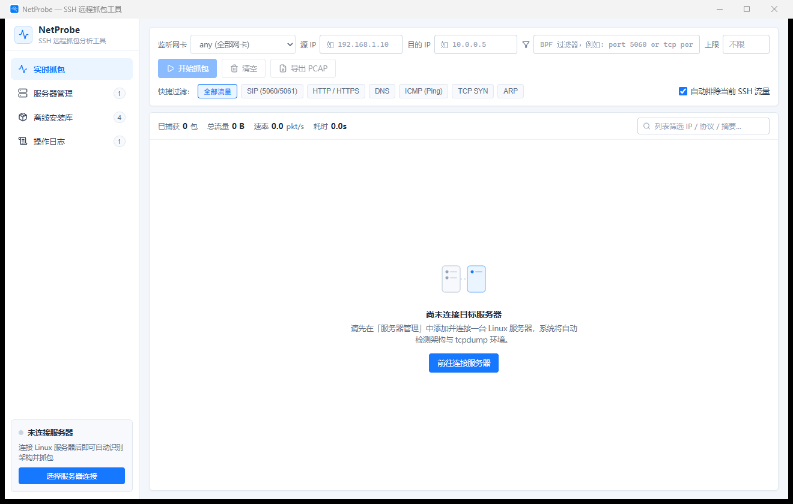
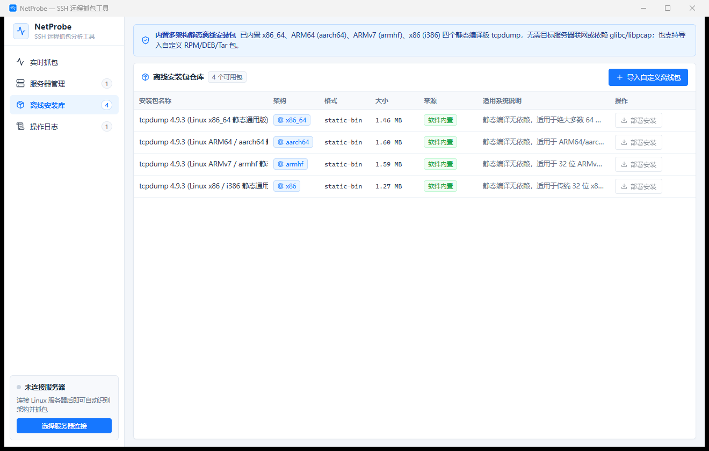
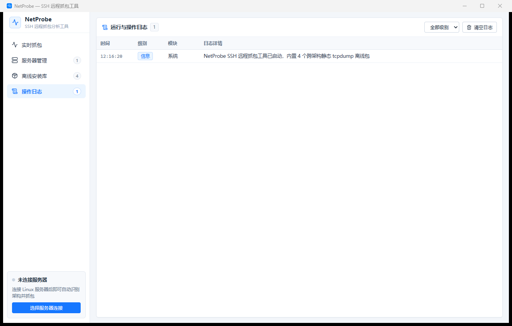

# NetProbe — SSH 远程抓包工具

[](https://github.com/kunker001/tcpdump_tool/actions/workflows/release.yml)
[](https://github.com/kunker001/tcpdump_tool/releases/latest)

基于 **Go + Wails + React (TypeScript)** 开发的 Windows 桌面端 SSH 远程网络抓包工具。支持通过 SSH 连接 Linux 服务器直接调用 `tcpdump` 实时流式抓包、协议解析与 Wireshark `.pcap` 导出；当目标服务器未安装 `tcpdump` 时，可根据系统架构与发行版自动离线安装。

## 界面预览

### 实时抓包工作台
支持选择远程监听网卡、独立 **源 IP** / **目的 IP** 过滤、自定义 BPF 表达式与快捷协议预设（含 `SIP (5060/5061)`、`HTTP/HTTPS`、`DNS`、`ICMP`、`TCP SYN`、`ARP`），默认自动排除当前 SSH 连接流量。



### 离线安装库（内置多架构静态包）
内置 4 个无依赖静态编译版 Linux `tcpdump 4.9.3`（`x86_64`、`aarch64`、`armhf`、`x86`），自动匹配目标服务器架构一键部署，并支持导入自定义 `.rpm` / `.deb` / `.tar.gz` / 静态二进制包。



### 运行与操作日志
完整记录 SSH 连接、环境检测、离线安装进度、抓包启停与 PCAP 导出日志，支持按级别筛选。



## 核心特性

- **SSH 远程连接与环境自检**：支持密码 / 私钥认证与 `sudo` 提权；连接后自动识别操作系统、CPU 架构、内核版本、网卡列表与 `tcpdump` 状态。
- **自动离线安装 `tcpdump`**：
  - 通过 `//go:embed` 内置 4 个跨架构静态编译版 Linux `tcpdump`（`x86_64` / `aarch64` / `armhf` / `x86`），单文件运行无需外网与依赖库。
  - 自动按架构匹配并通过 SFTP 上传安装（无 SFTP 环境自动回退 SSH 传输），配备 5 步可视化进度节点。
  - 支持导入自定义 `.rpm` / `.deb` / `.tar.gz` / 静态二进制包。
- **实时流式抓包与协议解析**：
  - 通过 `tcpdump -U -n -s 0 -w -` 实时拉取 libpcap 数据流，不占用远程服务器磁盘空间。
  - 纯 Go 解析 Ethernet / Linux SLL / VLAN / ARP / IPv4 / IPv6 / TCP / UDP / ICMP / DNS / HTTP / TLS / SSH / **SIP** 协议层级与十六进制 / ASCII 原始报文。
  - 支持一键导出标准 Wireshark `.pcap` 文件。
- **企业级桌面界面**：浅灰蓝底色 + 白色面板 + 明亮蓝色强调色，紧凑表格、线性图标与柔和空状态插画，默认采用 Microsoft YaHei 字体。

## 下载使用

前往 [Releases 页面](https://github.com/kunker001/tcpdump_tool/releases) 下载最新版本的 `NetProbe-*-windows-amd64.exe`（或 `.zip` 压缩包），双击即可直接运行，无需安装额外依赖。

## 本地开发与打包

### 环境要求
- Go 1.26+
- Node.js 18+
- Wails v2 CLI (`go install github.com/wailsapp/wails/v2/cmd/wails@latest`)

### 命令
```powershell
# 开发模式（热重载）
wails dev

# 运行单元测试
go test -v ./...

# 编译 Windows 生产版可执行文件 (输出至 build/bin/ssh-packet-capture.exe)
wails build
```

## 自动发布说明

仓库已配置 GitHub Actions 工作流（[.github/workflows/release.yml](.github/workflows/release.yml)）：推送任意 `v*` 标签（如 `git tag v20261125 && git push origin v20261125`）时，自动在 `windows-latest` 环境执行单元测试、Wails 编译打包并创建 GitHub Release，附带 `.exe`、`.zip` 及 `SHA256SUMS.txt`。
